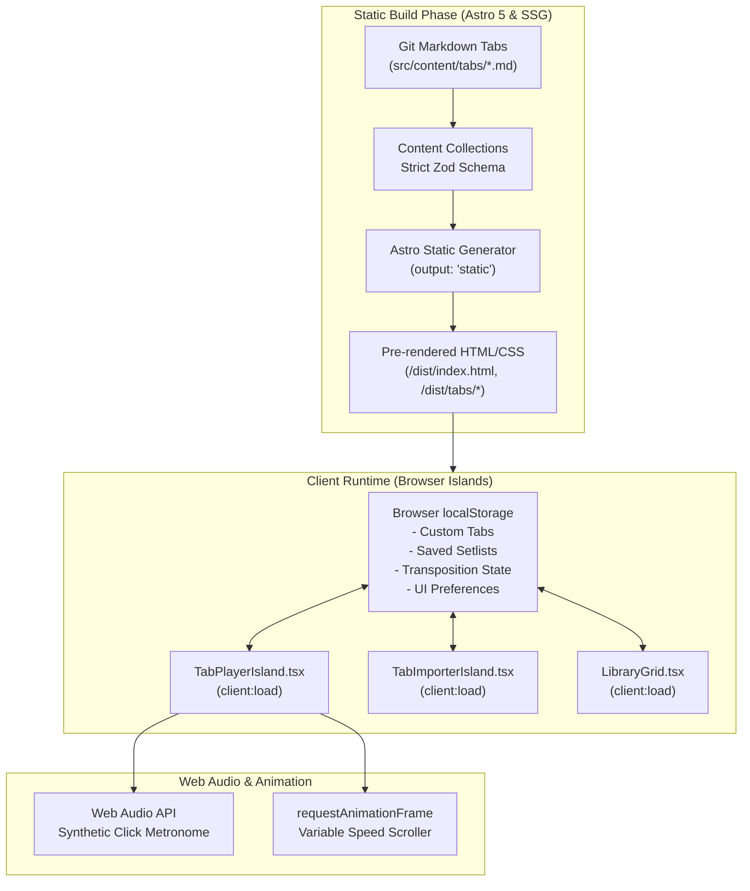

# The Cozy Strum — System Architecture & Data Flow

This document details the complete static architecture, data structures, and deployment pipelines for **The Cozy Strum**.

---

## 1. High-Level System Architecture



---

## 2. Content Collection Schema (`src/content/config.ts`)

Astro Content Collections enforce strict schema validation at build time via Zod:

```typescript
import { defineCollection, z } from 'astro:content';

export const tabsCollection = defineCollection({
  type: 'content',
  schema: z.object({
    title: z.string().min(1),
    artist: z.string().min(1),
    instrument: z.enum(['guitar', 'ukulele']).default('guitar'),
    tuning: z.string().default('Standard (E A D G B e)'),
    capo: z.number().int().min(0).max(12).default(0),
    bpm: z.number().int().min(30).max(300).optional(),
    difficulty: z.enum(['beginner', 'intermediate', 'advanced']).default('beginner'),
    strummingPattern: z.string().optional(), // e.g. "D - D U - U D U"
    tags: z.array(z.string()).default([]),
    isFingerstyle: z.boolean().default(false),
    key: z.string().optional(), // e.g. "G", "Am"
    createdAt: z.string().or(z.date()).transform((val) => new Date(val).toISOString())
  })
});

export const collections = {
  tabs: tabsCollection
};
```

---

## 3. Browser `localStorage` Schema

To enable instant importing without database dependencies, client state is stored across three typed keys:

### 3.1 `cozy_strum_custom_tabs`
Array of user-imported tabs from the Quick Paste Studio:
```typescript
export interface UserTab {
  id: string;               // e.g. "custom-hotel-california-1712345678"
  slug: string;             // URL-friendly slug
  title: string;
  artist: string;
  instrument: 'guitar' | 'ukulele';
  tuning: string;
  capo: number;
  bpm?: number;
  difficulty: 'beginner' | 'intermediate' | 'advanced';
  strummingPattern?: string;
  tags: string[];
  isFingerstyle: boolean;
  content: string;          // Raw markdown tab body
  createdAt: string;        // ISO timestamp
  isCustom: true;
}
```

### 3.2 `cozy_strum_setlists`
Curated collections of songs for practice sessions:
```typescript
export interface Setlist {
  id: string;
  name: string;
  description?: string;
  songSlugs: string[];      // References to either built-in or custom tab slugs
  updatedAt: string;
}
```

### 3.3 `cozy_strum_prefs`
Global UI and player settings:
```typescript
export interface UserPreferences {
  theme: 'parchment' | 'campfire';
  defaultInstrument: 'guitar' | 'ukulele';
  fontSize: 'sm' | 'base' | 'lg' | 'xl';
  autoScrollSpeed: number;  // 0.5 to 10.0
  columnMode: 'single' | 'two-column' | 'three-column';
  dockPosition: 'bottom' | 'top';
  metronomeVolume: number;  // 0.0 to 1.0
}
```

---

## 4. Netlify Deployment Architecture

The site builds into a pure static `/dist` directory with zero runtime Node server:

```toml
# netlify.toml
[build]
  command = "npm run build"
  publish = "dist"

[[headers]]
  for = "/*"
  [headers.values]
    X-Frame-Options = "DENY"
    X-Content-Type-Options = "nosniff"
    Referrer-Policy = "strict-origin-when-cross-origin"
    Permissions-Policy = "microphone=(), camera=(), geolocation=()"

[[headers]]
  for = "/_astro/*"
  [headers.values]
    Cache-Control = "public, max-age=31536000, immutable"

[[headers]]
  for = "/*.woff2"
  [headers.values]
    Cache-Control = "public, max-age=31536000, immutable"
```
