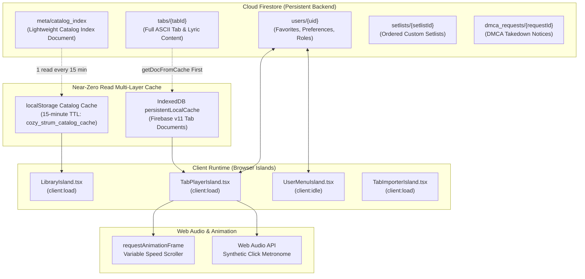

# The Cozy Strum — System Architecture & Data Flow

This document details the complete database-backed architecture, data structures, caching tiers, and deployment pipelines for **The Cozy Strum**.

---

## 1. High-Level System Architecture



---

## 2. Near-Zero Read Optimization Architecture

To prevent expensive Firestore document reads on high-traffic static deployments, four caching and aggregation strategies operate in tandem:

| Layer | Implementation | Read Impact |
|---|---|---|
| **1. Catalog Index Document (`meta/catalog_index`)** | A single document stores summaries of all approved public songs (`id`, `title`, `artist`, `instrument`, `tuning`, `capo`, `difficulty`, `isFingerstyle`, `chordsUsed`, `updatedAt`). The homepage loads in **1 single read** regardless of catalog size. | Reduces homepage cost from $N$ reads to 1 read. |
| **2. `localStorage` TTL Caching** | The parsed `meta/catalog_index` is stored in browser `localStorage` (`cozy_strum_catalog_cache`) with a 15-minute expiration timestamp. | **0 reads** on page refreshes and repeat homepage visits within 15 minutes. |
| **3. `getDocFromCache` First** | When navigating to `/tab?id=xyz`, the client calls `getDocFromCache(docRef)`. If present and the cached `updatedAt` matches the catalog index, Firestore is never queried. | **0 reads** on repeat practice sessions for songs in local cache. |
| **4. Debounced User Preference Writes** | Real-time adjustments to Transpose or Capo in the player UI update local memory instantly and debounce updates to `users/{uid}` by 2500ms. | Prevents write spikes during rapid key transpositions. |

---

## 3. Data Model Specifications

### 3.1 `meta/catalog_index`
```typescript
import type { SongCategory } from '../src/lib/types';

export interface TabSummary {
  id: string;
  slug: string;
  title: string;
  artist: string;
  album?: string;
  releaseYear?: number;
  category?: string;
  categories: SongCategory[];
  instrument: 'guitar' | 'ukulele';
  tuning: string;
  capo: number;
  bpm?: number;
  difficulty: 'Beginner' | 'Intermediate' | 'Advanced';
  isFingerstyle: boolean;
  chordsUsed: string[];
  updatedAt: string;
}

export interface CatalogIndexDoc {
  lastUpdated: string;
  totalCount: number;
  items: Record<string, TabSummary>;
  categoryCounts?: Partial<Record<SongCategory, number>>;
  decadeCounts?: Record<string, number>;
}
```

### 3.2 `tabs/{tabId}`
```typescript
export interface CloudTab extends TabSummary {
  content: string; // Full raw tab and lyric text
  strummingPattern?: string;
  lrclibId?: number;
  authorUid: string;
  authorName: string;
  visibility: 'private' | 'public';
  status: 'draft' | 'pending_review' | 'approved' | 'rejected' | 'removed_dmca';
  rejectionReason?: string;
  favoritesCount: number;
  viewsCount: number;
  createdAt: string;
}
```

---

## 4. Netlify Deployment & Dynamic Tab Routing

The site builds as a 100% static shell (`output: 'static'`) on Netlify with client-side hydration:

```toml
# netlify.toml
[build]
  command = "npm run build"
  publish = "dist"

[[headers]]
  for = "/*"
  [headers.values]
    X-Frame-Options = "DENY"
    X-Content-Type-Options = "nosniff"
    Referrer-Policy = "strict-origin-when-cross-origin"
    Permissions-Policy = "microphone=(), camera=(), geolocation=(), screen-wake-lock=(self)"

[[redirects]]
  from = "/tabs/*"
  to = "/tab?id=:splat"
  status = 200
```

---

## 5. Local Offline Audio-to-Chord Pipeline (`tools/chord-sync/`)

To populate chords automatically without manual transcription or speech-to-text AI:
1. **Host Environment:** Runs 100% locally on the creator's PC as an offline Python CLI. Never loaded in browser bundles.
2. **LRCLIB Ingestion:** Fetches millisecond-synced lyrics (`.lrc`) from `https://lrclib.net/api/get` based on song title and artist.
3. **Harmony Stem Isolation & Audio Estimation:** Uses `demucs` or `librosa` to separate audio stems and extracts timestamped chord changes via `chord-extractor`.
4. **Deterministic Colocation:** `sync_generator.py` maps chords into precise monospace column positions above lyrics based on shared millisecond timestamps.
5. **Output / Firestore Ingestion:** Outputs clean ASCII tabs or directly uploads to Firestore via `firebase-admin` with `status: 'draft'` or `status: 'pending_review'`.

