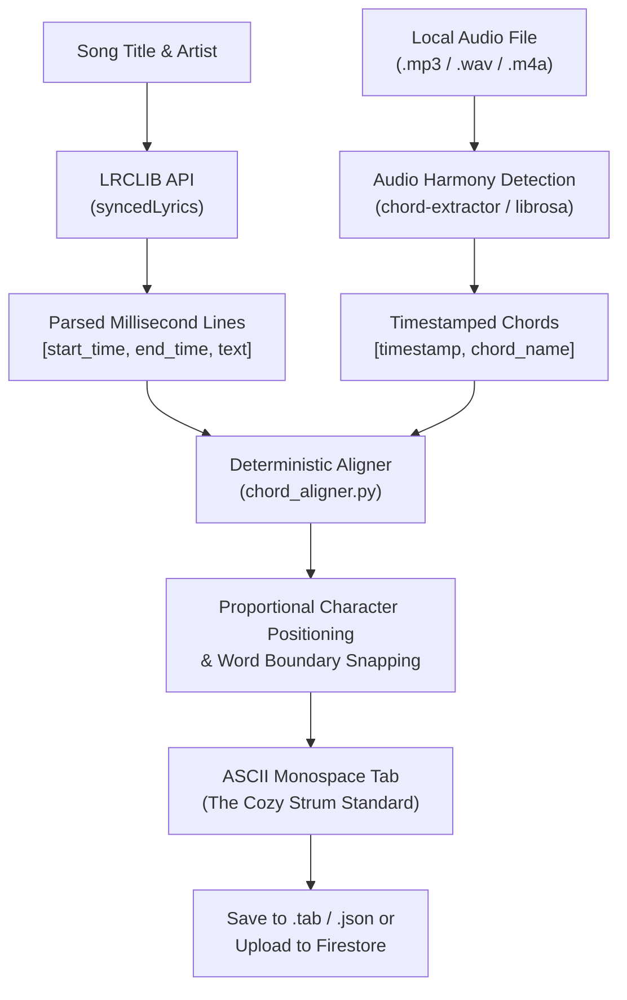

# The Cozy Strum — Local Audio + LRCLIB Automated Chord Sync Pipeline

A standalone Python CLI tool that runs on your local computer to automatically generate chord-over-lyrics tablature for **The Cozy Strum** by pairing **LRCLIB millisecond-synced lyrics (`.lrc`)** with open-source audio harmony/chord extraction (`chord-extractor`, `librosa`, or timestamped chord stems).

---

## 1. Why This Pipeline is Unique

Traditional automatic chord transcribers either:
1. Attempt heavy automatic speech recognition (ASR / Whisper) to find words in noisy audio, which frequently hallucinates or drops words during guitar solos, OR
2. Output raw timestamped chord lists (`14.2s C, 18.1s G`) that are completely detached from song lyrics.

### The Cozy Strum Approach
Instead of running heavy ASR models, this tool combines two open-source sources:
- **LRCLIB (`https://lrclib.net`)**: High-accuracy, community-verified millisecond timestamps for each line of lyrics (`[00:14.20] Wise men say only fools rush in`).
- **Audio Harmony Detection (`chord-extractor` / `librosa`)**: Detects musical chroma and chord shifts with exact audio timestamps (`14.1s C`, `16.4s Em`, `18.8s Am`).

The **Deterministic Timestamp Merger (`chord_aligner.py`)** maps every chord falling within a lyric line's time window proportionally across that line's character length, snaps to word boundaries, and avoids collisions—generating clean Cozy Strum ASCII tablatures ready for practice or 1-click import!



---

## 2. Requirements & Installation

Python 3.10+ is required.

```bash
# 1. Navigate to tools/chord-sync
cd tools/chord-sync

# 2. (Recommended) Create a virtual environment
python -m venv venv
# Windows:
.\venv\Scripts\activate
# Linux/macOS:
source venv/bin/activate

# 3. Install dependencies
pip install -r requirements.txt
```

> **Note:** The core lyrics retrieval and alignment engine uses Python's standard library with zero mandatory dependencies. `chord-extractor` and `librosa` are optional for audio processing, and `firebase-admin` is optional for direct Firestore upload.

---

## 3. CLI Usage & Examples

### Example 1: Generate Clean Lyrics Template (Dry Run)
Fetch millisecond-synced lyrics directly from LRCLIB and output a formatted practice sheet:
```bash
python sync_generator.py --title "Wonderwall" --artist "Oasis" --dry-run
```

### Example 2: Full Audio + Synced Lyrics Alignment
Align an audio file with LRCLIB lyrics and save as a Cozy Strum tab:
```bash
python sync_generator.py \
  --title "Take Me Home, Country Roads" \
  --artist "John Denver" \
  --audio "country_roads.mp3" \
  --output "country_roads.tab"
```

### Example 3: Use Local LRC File & Custom Chords
If you have a local `.lrc` file or `.chords` text file:
```bash
python sync_generator.py \
  --title "Hotel California" \
  --artist "Eagles" \
  --lrc-file "hotel_california.lrc" \
  --audio "chords.txt" \
  --capo 7 \
  --output "hotel_california.json"
```

### Example 4: Direct Upload to Firestore Vault
Upload directly to your Firestore database as a private tab:
```bash
python sync_generator.py \
  --title "Yesterday" \
  --artist "The Beatles" \
  --audio "yesterday.mp3" \
  --upload \
  --service-account "path/to/serviceAccountKey.json"
```

---

## 4. Supported CLI Flags

| Flag | Type | Description |
|---|---|---|
| `--title` | `str` *(Required)* | Song title (e.g., `'Wonderwall'`) |
| `--artist` | `str` *(Required)* | Artist name (e.g., `'Oasis'`) |
| `--audio` | `str` | Path to audio file (`.mp3`, `.wav`) or timestamped chord file (`.txt`) |
| `--lrc-file` | `str` | Path to local `.lrc` file (skips LRCLIB online API) |
| `--capo` | `int` | Capo position (default: `0`) |
| `--instrument` | `guitar \| ukulele` | Target instrument (default: `guitar`) |
| `--output` | `str` | Output file path (`.tab` or `.json`) |
| `--upload` | flag | Direct upload to Firestore `tabs/{tabId}` |
| `--service-account`| `str` | Path to Firebase service account JSON |
| `--dry-run` | flag | Print tab preview to console without saving |

---

## 5. Running the Test Suite

Run the unit test suite verifying timestamp parsing, proportional chord alignment, and collision avoidance:
```bash
python test_aligner.py
```
