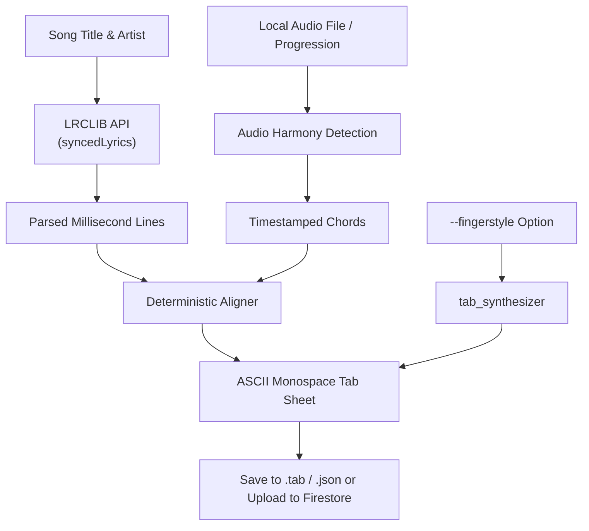

# The Cozy Strum — Local Audio + LRCLIB Automated Chord Sync Pipeline

A standalone Python CLI tool that runs on your local computer to automatically generate chord-over-lyrics tablature for **The Cozy Strum** by pairing **LRCLIB millisecond-synced lyrics (`.lrc`)** with local audio harmony extraction and procedural ASCII tab synthesis.

---

## 1. Why This Pipeline is Unique

### The Cozy Strum Approach
- **LRCLIB (`https://lrclib.net`)**: High-accuracy millisecond timestamps for each line of lyrics (`[00:14.20] Wise men say only fools rush in`). Multi-stage title normalization strips subtitles, soundtrack tags, and edition strings for 91%+ search accuracy.
- **Audio Harmony Detection (`chord-extractor` / `librosa`)**: 100% legal digital signal processing that detects musical chroma and chord shifts with exact audio timestamps (`14.1s C`, `16.4s Em`, `18.8s Am`) from local audio files.
- **Selective Fingerstyle Synthesizer (`tab_synthesizer.py`)**: Computes exact 6-line (guitar) and 4-line (ukulele) ASCII tab staves directly from fretboard geometry and music theory.
- **Zero Web Scraping**: Purely self-contained and ToS-compliant.



---

## 2. Requirements & Installation

Python 3.10+ is required.

```bash
cd tools/chord-sync
pip install -r requirements.txt
```

> **Note:** Lyrics retrieval, tab synthesis, and alignment engine use Python's standard library with zero mandatory external packages.

---

## 3. CLI Usage & Examples

### Example 1: Pure Chords-Over-Lyrics (Sing-Along / Strumming Song)
Generates clean distraction-free chords aligned over lyrics with zero unnecessary tab staves:
```bash
python sync_generator.py --title "Wonderwall" --artist "Oasis" --progression "Em7 G Dsus4 A7sus4" --dry-run
```

### Example 2: Procedural Fingerstyle Pattern (e.g. Ukulele or Guitar Ballad)
Synthesizes standard monospace ASCII tablatures for specific chord progressions:
```bash
python sync_generator.py \
  --title "Riptide" \
  --artist "Vance Joy" \
  --progression "Am G C" \
  --instrument ukulele \
  --fingerstyle arpeggio \
  --capo 1 \
  --dry-run
```

### Example 3: Full Audio + Synced Lyrics Alignment
Align an audio file with LRCLIB lyrics and save as a Cozy Strum tab:
```bash
python sync_generator.py \
  --title "Take Me Home, Country Roads" \
  --artist "John Denver" \
  --audio "country_roads.mp3" \
  --output "country_roads.tab"
```

### Example 4: Direct Upload to Firestore Vault
```bash
python sync_generator.py \
  --title "Yesterday" \
  --artist "The Beatles" \
  --progression "F Em7 A7 Dm" \
  --upload \
  --service-account "path/to/serviceAccountKey.json"
```

---

## 4. Supported CLI Flags

| Flag | Type | Description |
|---|---|---|
| `--title` | `str` *(Required)* | Song title (e.g., `'Wonderwall'`) |
| `--artist` | `str` *(Required)* | Artist name (e.g., `'Oasis'`) |
| `--progression` | `str` | Verse chord progression (e.g., `'Em7 G Dsus4 A7sus4'`) |
| `--chorus-progression`| `str` | Chorus chord progression |
| `--fingerstyle` | `travis \| arpeggio` | Procedural fingerstyle ASCII tab pattern |
| `--audio` | `str` | Path to audio file (`.mp3`, `.wav`) or chords file |
| `--lrc-file` | `str` | Path to local `.lrc` file (skips LRCLIB online API) |
| `--capo` | `int` | Capo position (default: `0`) |
| `--instrument` | `guitar \| ukulele` | Target instrument (default: `guitar`) |
| `--output` | `str` | Output file path (`.tab` or `.json`) |
| `--upload` | flag | Direct upload to Firestore `tabs/{tabId}` |
| `--service-account`| `str` | Path to Firebase service account JSON |
| `--dry-run` | flag | Print tab preview to console without saving |

---

## 5. Running the Test Suite

```bash
python test_aligner.py
```
